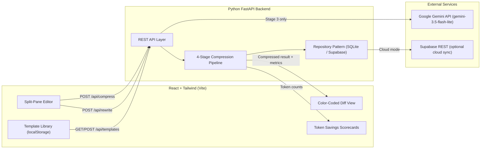
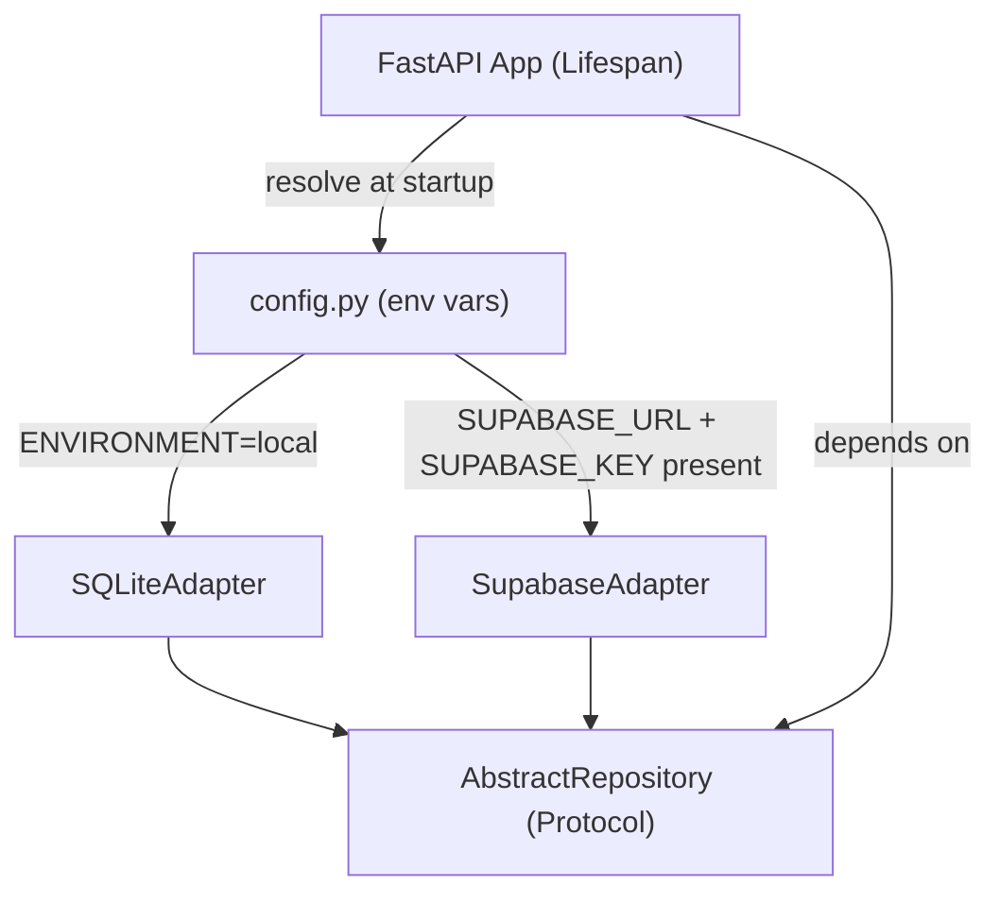
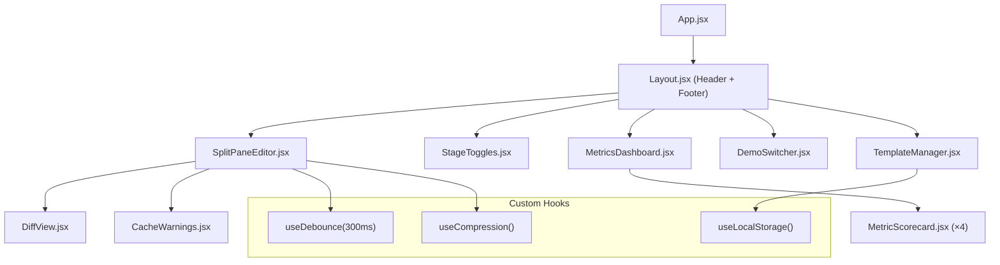
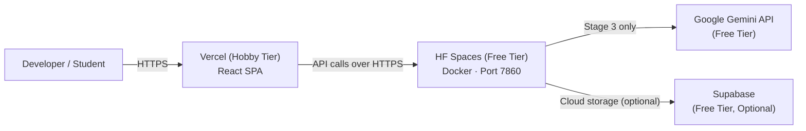

# PromptDiet — Architecture Document

> **Version:** 0.1.0 · **Last Updated:** 2026-11-13
> **Status:** Phase 0 — Design & Scaffolding

---

## 1. System Overview

PromptDiet is a **local-first visual workbench and API microservice** that compresses verbose LLM inputs (system prompts, build logs, MCP/JSON tool schemas) through a **4-stage deterministic pipeline** before they reach any LLM API.



---

## 2. Monorepo Directory Tree

```
PromptDiet/
├── backend/
│   ├── engine/                     # Core compression pipeline modules
│   │   ├── __init__.py
│   │   ├── log_deduplicator.py     # Stage 1: O(N) sliding-window log compressor
│   │   ├── json_crusher.py         # Stage 2: JSON/MCP schema minifier
│   │   ├── prompt_rewriter.py      # Stage 3: Gemini declarative rewriter client
│   │   ├── cache_aligner.py        # Stage 4: KV-cache prefix auditor
│   │   └── tokenizer.py           # tiktoken + Gemini token estimation wrapper
│   │
│   ├── db/                         # Hybrid persistence layer
│   │   ├── __init__.py
│   │   ├── repository.py           # Abstract Repository + SQLite/Supabase adapters
│   │   ├── sqlite_adapter.py       # SQLite implementation
│   │   ├── supabase_adapter.py     # Supabase REST HTTPS implementation
│   │   └── migrations.py           # Schema creation / migration helpers
│   │
│   ├── tests/                      # pytest test suite
│   │   ├── __init__.py
│   │   ├── conftest.py             # Shared fixtures (sample logs, schemas, prompts)
│   │   ├── test_log_deduplicator.py
│   │   ├── test_json_crusher.py
│   │   ├── test_cache_aligner.py
│   │   ├── test_tokenizer.py
│   │   ├── test_prompt_rewriter.py
│   │   └── test_api.py            # FastAPI TestClient integration tests
│   │
│   ├── fixtures/                   # Pre-loaded demo data
│   │   ├── build_log_400_lines.txt
│   │   ├── mcp_schema_50_tools.json
│   │   └── system_prompt_800_words.txt
│   │
│   ├── __init__.py
│   ├── main.py                     # FastAPI app entry, CORS, lifespan
│   ├── schemas.py                  # Pydantic v2 request/response models
│   ├── config.py                   # Environment-based settings (pydantic-settings)
│   ├── requirements.txt
│   └── Dockerfile                  # HF Spaces deployment (port 7860)
│
├── frontend/
│   ├── public/
│   │   └── favicon.svg
│   ├── src/
│   │   ├── components/
│   │   │   ├── Layout.jsx              # App shell with header + footer
│   │   │   ├── SplitPaneEditor.jsx     # Before/After split-pane editor
│   │   │   ├── DiffView.jsx            # Color-coded diff rendering
│   │   │   ├── MetricScorecard.jsx     # Individual metric card
│   │   │   ├── MetricsDashboard.jsx    # Grid of all scorecards
│   │   │   ├── StageToggles.jsx        # Pipeline stage on/off toggles
│   │   │   ├── TemplateManager.jsx     # Save/load/export templates
│   │   │   ├── DemoSwitcher.jsx        # One-click demo fixture selector
│   │   │   └── CacheWarnings.jsx       # KV-cache prefix violation alerts
│   │   │
│   │   ├── hooks/
│   │   │   ├── useDebounce.js          # Custom 300ms debounce hook
│   │   │   ├── useCompression.js       # API call + state management hook
│   │   │   └── useLocalStorage.js      # localStorage read/write hook
│   │   │
│   │   ├── utils/
│   │   │   ├── api.js                  # Axios/fetch wrapper for backend
│   │   │   ├── diffEngine.js           # Client-side diff computation
│   │   │   └── formatters.js           # Number/byte/dollar formatting helpers
│   │   │
│   │   ├── App.jsx
│   │   ├── App.css
│   │   ├── index.css                   # Tailwind directives
│   │   └── main.jsx                    # Vite entry point
│   │
│   ├── index.html
│   ├── tailwind.config.js
│   ├── postcss.config.js
│   ├── vite.config.js
│   ├── vercel.json                     # Vercel deployment config
│   ├── package.json
│   └── .env.example
│
├── ARCHITECTURE.md                 # ← This file
├── PLAN.md                         # Phased implementation checklist
├── README.md                       # Project overview & usage
├── .gitignore
└── .env.example                    # Root env template
```

---

## 3. The 4-Stage Compression Pipeline

Each stage is **independently toggleable** via boolean flags in the API request. Stages execute sequentially; the output of one feeds into the next.

### Stage 1 — Log Deduplicator (`log_deduplicator.py`)

| Aspect | Detail |
|---|---|
| **Algorithm** | Single-pass sliding window with normalized line-signature hashing |
| **Pre-hash normalization** | Regex strips ISO timestamps (`\d{4}-\d{2}-\d{2}[T ]\d{2}:\d{2}:\d{2}`), hex memory addresses (`0x[0-9a-fA-F]+`), PIDs, and UUIDs before hashing |
| **Deduplication** | Sequential lines with identical normalized hashes collapse → `[… repeated N times]` |
| **Error preservation** | Lines matching heuristics (`FAIL`, `ERROR`, `Exception`, `Traceback`, non-zero exit codes, `FATAL`, `WARN`) **bypass** truncation entirely |
| **Context buffer** | A `collections.deque(maxlen=k)` (default k=3) preserves the k lines *preceding* each error line, ensuring stack-trace context survives |
| **Complexity** | **Time:** O(N) single pass · **Space:** O(k) auxiliary for the context deque |

### Stage 2 — JSON & MCP Schema Crusher (`json_crusher.py`)

| Aspect | Detail |
|---|---|
| **Whitespace minification** | `json.dumps(obj, separators=(',', ':'))` — removes all formatting whitespace |
| **Boilerplate stripping** | Removes non-functional keys configurable via a strip list (e.g., `"$schema"`, `"description"` on deeply nested params, `"examples"`, `"x-*"` extension keys) |
| **Array schema dedup** | When a JSON array contains N objects with identical key structures, replaces with 1 representative object + `"__repeated": N` annotation |
| **Structural validation** | Output is re-parsed with `json.loads()` post-compression to guarantee valid JSON |

### Stage 3 — Declarative Prompt Rewriter (`prompt_rewriter.py`)

| Aspect | Detail |
|---|---|
| **Trigger** | **Only** invoked on explicit user request via `POST /api/rewrite` (never automatic) |
| **Model** | `gemini-3.5-flash-lite` via the official `google-genai` Python SDK |
| **System instruction** | Converts verbose narrative prose → pipe-delimited declarative constraints (e.g., `"Format: bullet points \| Max: 100 words \| Omit: preamble"`) |
| **Output validation** | Gemini response is validated against a Pydantic model enforcing max token reduction targets and format constraints |
| **Fallback** | If Gemini API is unavailable or env vars are missing, returns original text + a warning flag |

### Stage 4 — KV-Cache Prefix Auditor (`cache_aligner.py`)

| Aspect | Detail |
|---|---|
| **Scan window** | Configurable prefix size (default: first 20% of total prompt or first 500 tokens, whichever is smaller) |
| **Detection patterns** | Regex patterns for volatile variables: ISO timestamps, UUIDs (v4), Unix epoch timestamps, random session/request IDs, `datetime.now()` outputs |
| **Output** | List of `CacheViolation` objects with `{line_number, column, matched_text, pattern_name, suggestion}` |
| **Recommendation** | Suggests moving each detected volatile variable to the prompt suffix (after the stable prefix) to maximize KV-cache hit rates |

---

## 4. API Contracts (Pydantic v2 Schemas)

### 4.1 Compression Request — `POST /api/compress`

```python
class CompressRequest(BaseModel):
    """Main compression pipeline request."""
    content: str                                    # Raw input text (prompt, log, or JSON)
    content_type: Literal["log", "json", "prompt", "auto"]  # Input classification (auto = detect)
    stages: StageConfig                             # Which pipeline stages to enable

    class StageConfig(BaseModel):
        log_dedup: bool = True                      # Stage 1
        json_crush: bool = True                     # Stage 2
        cache_audit: bool = True                    # Stage 4
        # Stage 3 (rewrite) has its own endpoint

    class Config:
        json_schema_extra = {
            "example": {
                "content": "2026-11-13 10:00:01 INFO Building module X...\n...",
                "content_type": "log",
                "stages": {"log_dedup": True, "json_crush": False, "cache_audit": False}
            }
        }
```

### 4.2 Compression Response

```python
class CompressResponse(BaseModel):
    """Compression pipeline result with full metrics."""
    original: str                                   # Original input (echoed back)
    compressed: str                                 # Compressed output
    metrics: CompressionMetrics
    cache_violations: list[CacheViolation] = []     # Stage 4 results (if enabled)
    stages_applied: list[str]                       # Which stages actually ran

class CompressionMetrics(BaseModel):
    original_chars: int
    compressed_chars: int
    original_tokens: int                            # tiktoken cl100k_base count
    compressed_tokens: int
    token_reduction_pct: float                      # e.g., 57.3
    estimated_cost_saved_usd: float                 # Based on GPT-4o input pricing
    processing_time_ms: float                       # Backend latency
    gemini_token_estimate: int | None = None        # Optional Gemini token count

class CacheViolation(BaseModel):
    line_number: int
    column: int
    matched_text: str
    pattern_name: str                               # e.g., "iso_timestamp", "uuid_v4"
    suggestion: str                                 # Human-readable fix suggestion
```

### 4.3 Rewrite Request — `POST /api/rewrite`

```python
class RewriteRequest(BaseModel):
    """Gemini-powered declarative rewrite request."""
    content: str                                    # Verbose system prompt text
    max_output_tokens: int = 200                    # Gemini generation cap
    style: Literal["pipe_delimited", "bullet", "minimal"] = "pipe_delimited"

class RewriteResponse(BaseModel):
    original: str
    rewritten: str
    metrics: CompressionMetrics
    gemini_model_used: str                          # e.g., "gemini-3.5-flash-lite"
    was_fallback: bool = False                      # True if Gemini was unavailable
```

### 4.4 Template CRUD — `GET/POST /api/templates`

```python
class TemplateCreate(BaseModel):
    name: str
    content: str
    content_type: Literal["log", "json", "prompt"]
    tags: list[str] = []

class TemplateResponse(BaseModel):
    id: str                                         # UUID
    name: str
    content: str
    content_type: str
    tags: list[str]
    created_at: str                                 # ISO 8601
    updated_at: str

class TemplateList(BaseModel):
    templates: list[TemplateResponse]
    total: int
```

### 4.5 Demo Fixtures — `GET /api/fixtures`

```python
class FixtureResponse(BaseModel):
    name: str                                       # e.g., "400-Line Build Log"
    description: str
    content: str
    content_type: Literal["log", "json", "prompt"]
```

---

## 5. Database Schema

Two tables, identical across SQLite and Supabase:

### `prompt_templates`

```sql
CREATE TABLE IF NOT EXISTS prompt_templates (
    id              TEXT PRIMARY KEY,                -- UUID v4
    name            TEXT NOT NULL,
    content         TEXT NOT NULL,
    content_type    TEXT NOT NULL CHECK (content_type IN ('log', 'json', 'prompt')),
    tags            TEXT DEFAULT '[]',               -- JSON array stored as TEXT
    created_at      TEXT NOT NULL DEFAULT (datetime('now')),
    updated_at      TEXT NOT NULL DEFAULT (datetime('now'))
);
```

### `compression_runs`

```sql
CREATE TABLE IF NOT EXISTS compression_runs (
    id                      TEXT PRIMARY KEY,        -- UUID v4
    template_id             TEXT,                    -- FK → prompt_templates.id (nullable for ad-hoc runs)
    content_type            TEXT NOT NULL,
    original_tokens         INTEGER NOT NULL,
    compressed_tokens       INTEGER NOT NULL,
    token_reduction_pct     REAL NOT NULL,
    estimated_cost_saved    REAL NOT NULL,           -- USD
    processing_time_ms      REAL NOT NULL,
    stages_applied          TEXT NOT NULL,            -- JSON array, e.g. '["log_dedup","cache_audit"]'
    cache_violations_count  INTEGER DEFAULT 0,
    created_at              TEXT NOT NULL DEFAULT (datetime('now')),
    FOREIGN KEY (template_id) REFERENCES prompt_templates(id) ON DELETE SET NULL
);
```

---

## 6. Hybrid Storage — Repository Pattern



**Resolution logic in `config.py`:**

1. If `SUPABASE_URL` and `SUPABASE_KEY` are set → use `SupabaseAdapter` (cloud mode)
2. Else → use `SQLiteAdapter` with local file `data/promptdiet.db` (created automatically)
3. The React frontend **always** mirrors templates in `localStorage` as a client-side cache and offline fallback

---

## 7. Frontend Component Architecture



**Data flow:** User types in left pane → `useDebounce` (300ms) → `useCompression` calls `POST /api/compress` → response updates right pane (compressed text), `DiffView` (color-coded changes), `MetricsDashboard` (token counts, savings), and `CacheWarnings` (violations list).

---

## 8. Environment Variables

| Variable | Required | Default | Description |
|---|---|---|---|
| `ENVIRONMENT` | No | `local` | `local` or `production` |
| `SQLITE_PATH` | No | `data/promptdiet.db` | Local SQLite file path |
| `SUPABASE_URL` | No | — | Supabase project URL (enables cloud storage) |
| `SUPABASE_KEY` | No | — | Supabase anon/service key |
| `GEMINI_API_KEY` | No | — | Google AI Studio API key for Stage 3 rewriter |
| `CORS_ORIGINS` | No | `["http://localhost:5173"]` | Allowed CORS origins (JSON array) |
| `LOG_CONTEXT_LINES` | No | `3` | Number of context lines to preserve before errors (k) |
| `CACHE_PREFIX_RATIO` | No | `0.2` | Fraction of prompt to scan for cache violations |
| `PORT` | No | `7860` | Server port (HF Spaces expects 7860) |

---

## 9. Deployment Topology



- **Frontend (Vercel):** Static SPA, `vercel.json` rewrites `/api/*` to HF Spaces backend
- **Backend (HF Spaces):** Dockerfile with non-root user 1000, exposes port 7860, `CMD ["uvicorn", "backend.main:app"]`
- **Gemini API:** Only called when user explicitly clicks "Rewrite with Gemini" (zero cost for deterministic stages)
- **Supabase:** Optional cloud persistence; app is fully functional with SQLite alone

